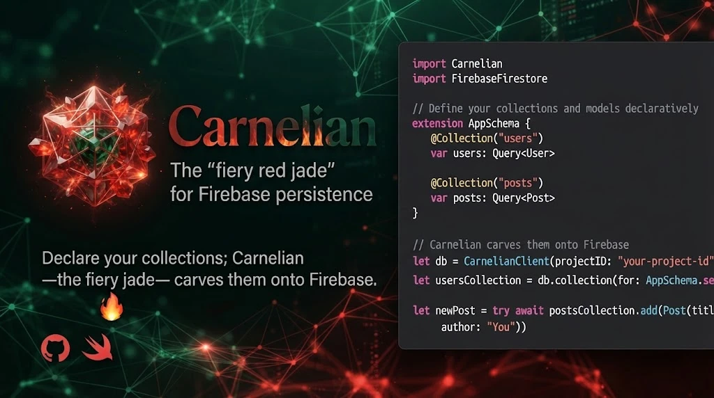

<div align="center">



# Carnelian

**The “fiery red jade” for Firebase persistence.**

*Declare your collections; Carnelian — the fiery jade — carves them onto Firebase.* 🔥

[](https://swift.org)
[](#)
[](LICENSE)

</div>

---

Carnelian is the sibling of [**JadeApi**](https://github.com/fsaldivar-dev/jade-api). Where
**Jade** declares your HTTP endpoints with annotations and runs them, **Carnelian** declares your
**Firestore** collections and carves out the repository that reads, writes, merges and soft-deletes
them — so each collection lives in one declarative place instead of hand-written boilerplate.

> 💚 **Jade** (green gem) → networking · ❤️ **Carnelian** (the fiery “red jade”) → Firebase

## Why

You end up writing the same `FirestoreMemberRepository` over and over: `data(as:)` to decode,
`setData(from:)` to write, `merge: true` to patch, a soft-delete convention, a server timestamp.
Carnelian turns that into a typed, declarative surface.

## Install

Swift Package Manager:

```swift
.package(url: "https://github.com/fsaldivar-dev/carnelian-api.git", from: "0.1.0")
```

Then add `Carnelian` (plus `CarnelianAuth` for account linking, and
`CarnelianTesting` in your test target).

## Usage

### Declarative (works now ✨)

```swift
import Carnelian

struct User: CarnelianModel {
    @Document var id: String?        // Firestore document id
    var name: String
    var isActive: Bool
}

// @Repository injects the client + init; @Collection vends each typed collection.
@Repository
actor AppRepository {
    @Collection("users") var users: Query<User>
    @Collection("posts") var posts: Query<Post>
}

let repo = AppRepository()
let active = try await repo.users.active().get()
```

### Protocol mode — the macro writes the implementation

Declare a protocol; `@Repository` generates a conforming `…Live` struct. The
access level is inherited, so a `public protocol` yields a `public struct`:

```swift
@Repository
protocol GymRepository {
    @Collection("members") var members: Query<User> { get }
    @Collection("classes") var classes: Query<Post> { get }
}

// @Repository generates:
// struct GymRepositoryLive: GymRepository {
//     private let client: CarnelianClient
//     init(client: CarnelianClient = CarnelianClient()) { … }
//     var members: Query<User> { client.collection("members") }
//     var classes: Query<Post> { client.collection("classes") }
// }

let repo: GymRepository = GymRepositoryLive()
let active = try await repo.members.active().get()
```

### Runtime (works today)

```swift
import Carnelian

let db = CarnelianClient()                       // default Firestore
let users = db.collection("users", of: User.self)

// Read (soft-delete aware, server-side count)
let active = try await users.active().order(by: "name").get()
let count  = try await users.count()

// Write
let id = try await users.add(User(id: nil, name: "Ana", isActive: true))
try await users.update(id, fields: ["name": "Ana María"])

// Delete (prefer soft delete)
try await users.softDelete(id)
```

### Testing without a network

```swift
import CarnelianTesting

let users = InMemoryCollection<User>([User(id: "1", name: "Ana", isActive: true)])
let all = await users.get()
```

## Try it

A no-config, runnable walkthrough (CRUD against the in-memory collection):

```bash
swift run CarnelianDemo
```

Want to see what the annotations generate? Dump the macro expansions:

```bash
swift build --target CarnelianDemo -Xswiftc -Xfrontend -Xswiftc -dump-macro-expansions
```

```swift
// @Repository       → private let client + init(client:)
// @Collection("users") → var users: Query<User> { get { client.collection("users") } }
```

## Account linking (`CarnelianAuth`)

Link several sign-in providers to **one** Firebase user — the official Firebase
model (linked providers share one UID). Carnelian owns the *flow*; your app owns
the merge *policy* via `AccountMerger`.

```swift
import CarnelianAuth

let authn = CarnelianAuth()

// Happy path: link a second provider to the signed-in user (same UID).
switch try await authn.link(.google(idToken: idToken, accessToken: accessToken)) {
case .linked(let uid):            print("linked into \(uid)")
case .merged(let kept, let orphan): print("merged \(orphan) → \(kept)")
}

// Collision — the provider already belongs to another account:
do {
    try await authn.link(.apple(idToken: token, rawNonce: nonce))
} catch CarnelianAuthError.credentialInUse {
    try await authn.resolveCollision(.apple(idToken: token, rawNonce: nonce), merging: myMerger)
}

authn.linkedProviders            // ["password", "google.com"]
try await authn.unlink("google.com")
```

Your app supplies the policy — Carnelian never knows your collections:

```swift
struct SajaruMerger: AccountMerger {
    func merge(from orphanUID: String, into baseUID: String) async throws {
        // reassign check_ins.userId / payments.userId, repoint members.linkedUserId,
        // inherit role, soft-delete users/orphanUID …
    }
}
```

> The client **cannot** delete the orphan's Firebase Auth account — only the Admin
> SDK can. `LinkOutcome.merged` hands you the `orphanUID` so your backend finishes it.

## Design

- **One place per collection.** The annotation holds the path; the repository is generated.
- **Mirrors proven patterns.** CRUD, `merge: true`, soft-delete and `serverTimestamp()` match the
  hand-written repositories they replace.
- **Hand-mockable.** `CarnelianTesting` gives you an in-memory collection; no emulator required.
- **Release-safe.** Test helpers are a separate product, kept out of release builds.

## Roadmap

- [x] Runtime: `CarnelianClient`, typed `Query<Element>`, CRUD, soft-delete, count
- [x] `CarnelianTesting` in-memory collection
- [x] **Macro engine** — `@Repository` injects client+init, `@Collection` vends typed collections, `@Document` maps to Firestore `@DocumentID`
- [x] **Peer-type generation** — `@Repository` on a `protocol` generates a conforming `<Name>Live` type (access level inherited)
- [ ] Named databases per environment (`test` / `stage` / `prod`)
- [ ] Listeners / snapshots (live queries)
- [ ] Batched writes & transactions

## License

[MIT](LICENSE) © Francisco Saldivar ([@fsaldivar-dev](https://github.com/fsaldivar-dev))
